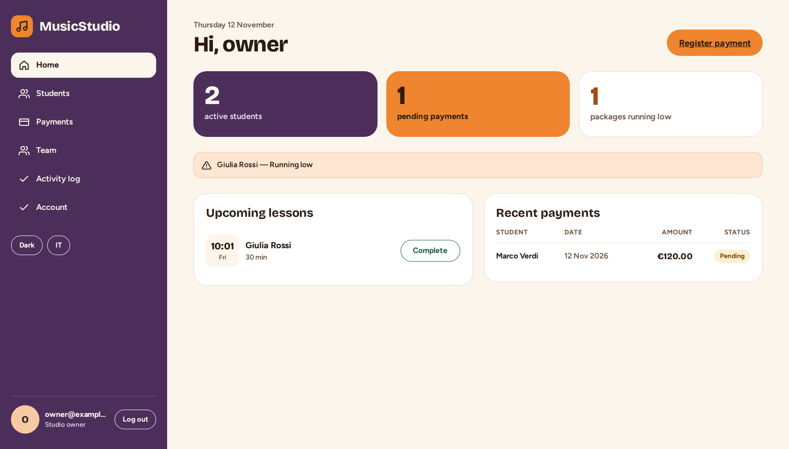
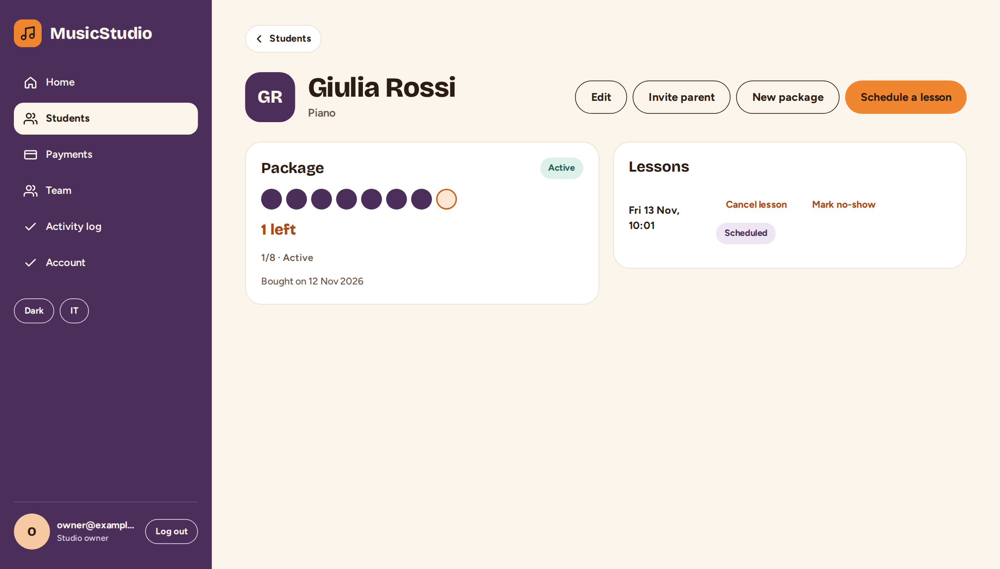
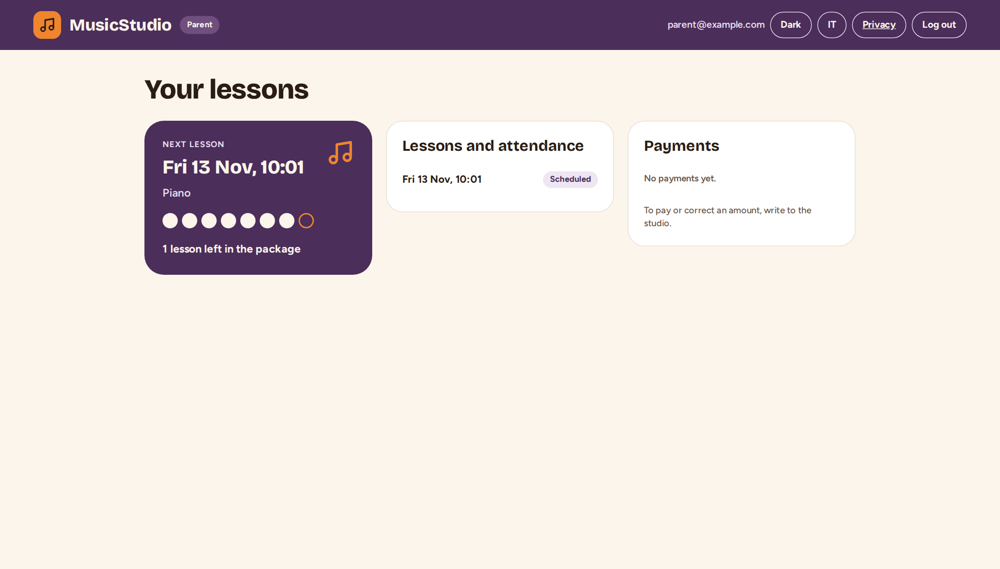
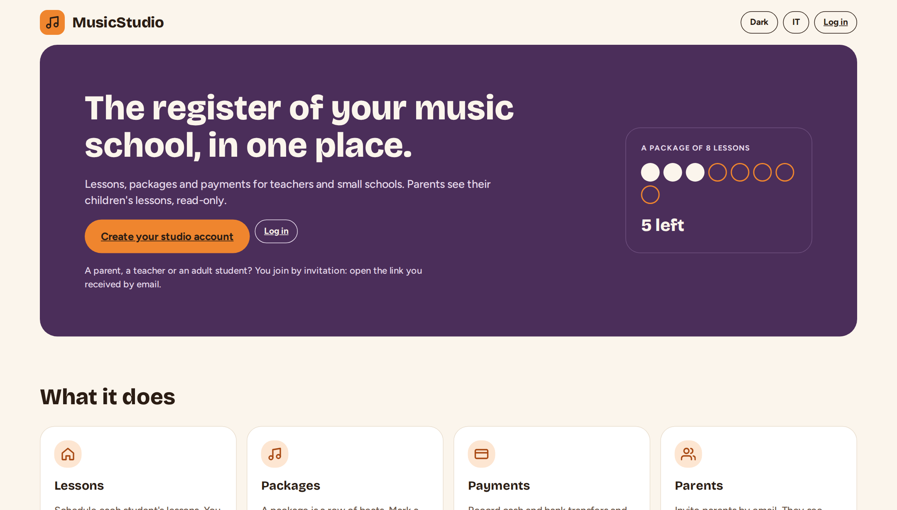
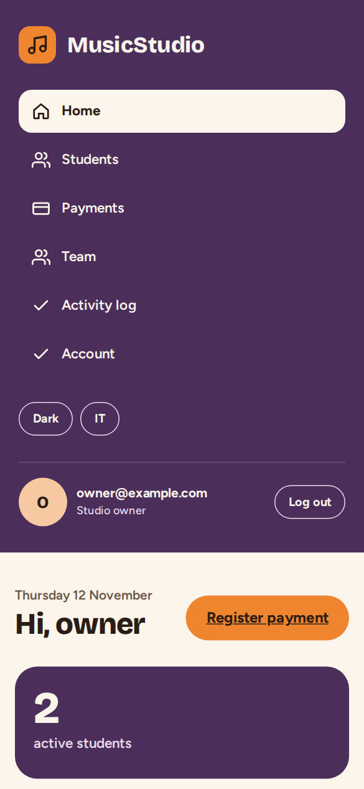
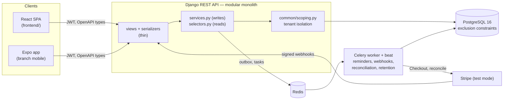

<div align="center">


# MusicStudio

**Lessons, prepaid packages and payments for private music teachers and small studios.**<br>
A production-grade Django REST API, a React web portal and an Expo mobile app, built spec-first.

[](https://github.com/aZaChris/MusicStudio/actions/workflows/ci.yml)


[](LICENSE)

[Features](#features) · [Screenshots](#screenshots) · [Architecture](#architecture) ·
[Engineering highlights](#engineering-highlights) · [Quick start](#quick-start) · [Docs](#documentation)

</div>

<picture>
  <source media="(prefers-color-scheme: dark)" srcset="docs/assets/screenshots/home-dark.png">
  
</picture>

## Status

**Staging, not production.** The stack runs on a self-hosted [Coolify](https://coolify.io) server:
the web portal is at <https://stagingwebmusic.christianseminerio.dev/> and the API at
`https://stagingapimusic.christianseminerio.dev/api/v1`. There are no real users yet, Stripe is in
test mode, and the privacy texts in `docs/privacy/` are drafts waiting for a legal review.

## Why it exists

A music teacher with twenty students runs the business on paper or in a spreadsheet: who has
lessons left in their package, who paid, who skipped last week. MusicStudio replaces that with
one register: the teacher schedules lessons, each completed lesson consumes one "beat" of a
prepaid package, payments are recorded or paid online, and parents follow their child's lessons
from a read-only portal.

It is also a deliberate training ground: every phase ships with its tests, an ADR for each
non-obvious decision and study notes (in Italian) that explain the concept behind it.

## Features

- **Studios as tenants**: a solo teacher or a studio with an owner and several teachers;
  invitations with role, consent and expiry.
- **Lessons**: recurring weekly slots, completion with notes, cancellation, no-shows, and a
  database guarantee that no teacher or student is ever double-booked.
- **Packages**: prepaid bundles shown as a row of beats; one lesson consumes one beat, exactly
  once, even under concurrent requests. "Running low" alerts below three.
- **Payments**: cash and bank transfers recorded by the teacher, or Stripe Checkout
  (test mode) fulfilled only by verified, idempotent webhooks, with hourly reconciliation.
- **Parent portal**: next lesson, attendance and payments, read-only.
- **Accounts and security**: sign-up with email confirmation, password reset, lockout, TOTP
  two-factor with recovery codes, rotating refresh tokens with revocation.
- **Privacy**: GDPR export and erasure (as anonymisation that keeps accounting records),
  retention jobs, an audit log, and lesson notes encrypted at rest.

## Screenshots

| Student and package | Parent portal |
|---|---|
| <picture><source media="(prefers-color-scheme: dark)" srcset="docs/assets/screenshots/student-dark.png"></picture> | <picture><source media="(prefers-color-scheme: dark)" srcset="docs/assets/screenshots/parent-dark.png"></picture> |
| **Landing** | **On a phone** |
| <picture><source media="(prefers-color-scheme: dark)" srcset="docs/assets/screenshots/landing-dark.png"></picture> | <picture><source media="(prefers-color-scheme: dark)" srcset="docs/assets/screenshots/home-mobile-dark.png"></picture> |

Light or dark follows your GitHub theme. Screenshots are taken from the production build against
the real API with demo data (`scripts/readme-screenshots.mjs`).

## Architecture



One Django app per domain (`accounts`, `studios`, `students`, `lessons`, `packages`,
`payments`, `notifications`, `privacy`, `audit`, plus `common`). Writes live in `services.py`,
reads in `selectors.py`; views and serializers stay thin. The OpenAPI contract
(`backend/openapi.yaml`) is committed and checked in CI, and both clients generate their types
from it.

## Engineering highlights

Each line links to the decision record or study note that explains it.

- **Tenant isolation for reads and writes**, enforced in one place at the ORM level and proven
  by a cross-tenant IDOR test suite. → [multi-tenancy](docs/learning/concetti/multi-tenancy.md),
  [BOLA](docs/learning/concetti/isolamento-tenant-e-bola.md)
- **No double booking, even under concurrency**: PostgreSQL exclusion constraints, with a
  retry-then-409 guard for the deadlocks they can cause.
  → [exclusion constraints](docs/learning/concetti/exclusion-constraint.md)
- **Payments that cannot be fulfilled twice**: signature-checked Stripe webhooks from an IP
  allowlist, processed idempotently, plus hourly reconciliation.
  → [idempotent webhooks](docs/learning/concetti/webhook-idempotenti.md),
  [real client IP](docs/learning/concetti/ip-reale-dietro-proxy.md)
- **Reliable background work**: an outbox for reminders, idempotent Celery tasks, and an API
  that stays up when Redis is down (throttles fail open).
  → [idempotent tasks](docs/learning/concetti/task-celery-idempotenti.md)
- **Performance with evidence**: query-count budgets on the main endpoints, and a Locust
  baseline at 50 users over 78,000 lessons with 0 errors and read p95 ≤ 110 ms on a laptop.
  → [N+1](docs/learning/concetti/orm-e-problema-n-piu-1.md),
  [load test](docs/loadtest/2026-11-09/README.md)
- **Security reviewed every phase** against the OWASP API Security Top 10, with a verdict and a
  proof for each risk. → [OWASP walk](docs/learning/concetti/sicurezza-api-owasp.md)
- **Operable in production**: JSON logs with request IDs, Sentry, liveness and readiness
  probes, off-site backups with a restore drill, Docker Compose on Coolify.
  → [runbook](docs/operations/runbook.md)

## Tech stack

| Layer | Choice |
|---|---|
| API | Python 3.12, Django 5.2 LTS, Django REST Framework, simplejwt, drf-spectacular |
| Data and jobs | PostgreSQL 16 (CI also on 18), Redis, Celery worker and beat |
| Payments | Stripe Checkout, test mode only |
| Web | React 19, TypeScript, Vite, TanStack Query, Vitest, design tokens in `design/system/` |
| Mobile | Expo (React Native), on branch [`mobile`](https://github.com/aZaChris/MusicStudio/tree/mobile) |
| Quality | pytest + factory_boy on real PostgreSQL, 90% coverage floor, ruff, mypy, pre-commit, gitleaks |
| Deploy | Docker Compose on self-hosted [Coolify](https://coolify.io), Sentry; no AWS |

## Quick start

With Docker:

```bash
cp .env.example .env
docker compose up --build                                  # API on http://localhost:8000
docker compose exec backend python manage.py seed_demo    # demo data (DEBUG only)
docker compose --profile frontend up                       # web portal on http://localhost:5173
```

Without Docker (PostgreSQL reachable through `DATABASE_URL`):

```bash
cd backend && uv sync
cp ../.env.example .env                                    # then point DATABASE_URL at your PostgreSQL
uv run python manage.py migrate && uv run python manage.py seed_demo
uv run python manage.py runserver
cd ../frontend && npm ci && npm run dev
```

Demo logins (password `password123`): `owner@example.com`, `solo.teacher@example.com`,
`parent@example.com`. API docs at `http://localhost:8000/api/docs/`.

### Quality gate (the same as CI)

```bash
cd backend
uv run ruff check . && uv run ruff format --check .
uv run mypy .
uv run python manage.py makemigrations --check --dry-run
uv run pytest                     # needs PostgreSQL; fails under 90% coverage
cd ../frontend && npm run lint && npm test && npm run build
```

### Deploy

`docker-compose.coolify.yml` is the production stack (health checks, memory limits, backups, no
published ports). Deploy steps, backups and incident procedures are in the runbook,
[`docs/operations/runbook.md`](docs/operations/runbook.md).

## Documentation

The study documentation is a deliverable, written in Italian:

- [`docs/learning/00-indice.md`](docs/learning/00-indice.md): reading order and phase summaries.
- [`docs/learning/adr/`](docs/learning/adr/): 32 architecture decision records.
- [`docs/learning/concetti/`](docs/learning/concetti/): 30 concept notes, from N+1 queries to TOTP.
- [`docs/knowledge-base/`](docs/knowledge-base/README.md): non-trivial problems, their root
  cause and how it was confirmed.
- [`specs/`](specs/): spec-kit artifacts (spec, plan, tasks) for every feature;
  principles in [`.specify/memory/constitution.md`](.specify/memory/constitution.md).

## Roadmap

- [x] Production foundations: settings, CI, health checks, Docker
- [x] Domain integrity: exclusion constraints, concurrency-safe packages
- [x] Celery and Stripe payments (test mode)
- [x] Production readiness: Sentry, JSON logs, load test, off-site backups, OWASP, token revocation
- [x] Web portal hardening: rotating-token session, generated types, every page, tests
- [x] Security, privacy and accounts: sign-up, invitations, MFA, GDPR, audit log, encryption
- [ ] Polish: API versioning and deprecation, admin hardening, public write-up

Releases follow the phases: see [Releases](https://github.com/aZaChris/MusicStudio/releases).

## Repository layout

```text
backend/            Django project (uv): config/, apps/<domain>/, Dockerfile, openapi.yaml
frontend/           React SPA (Vite): pages, generated API types, Vitest tests
design/system/      design tokens and CSS kit shared with the mobile app
docs/               study docs, knowledge base, operations, load tests, privacy
specs/              spec-kit artifacts per feature
scripts/            study-docs export, README screenshots
```

Branches: `main` is the production line for the API and the web portal; `mobile` holds the
Expo app. Earlier rewrites are kept as `archive/*` tags.

## License

[MIT](LICENSE) © 2026 Christian Seminerio
